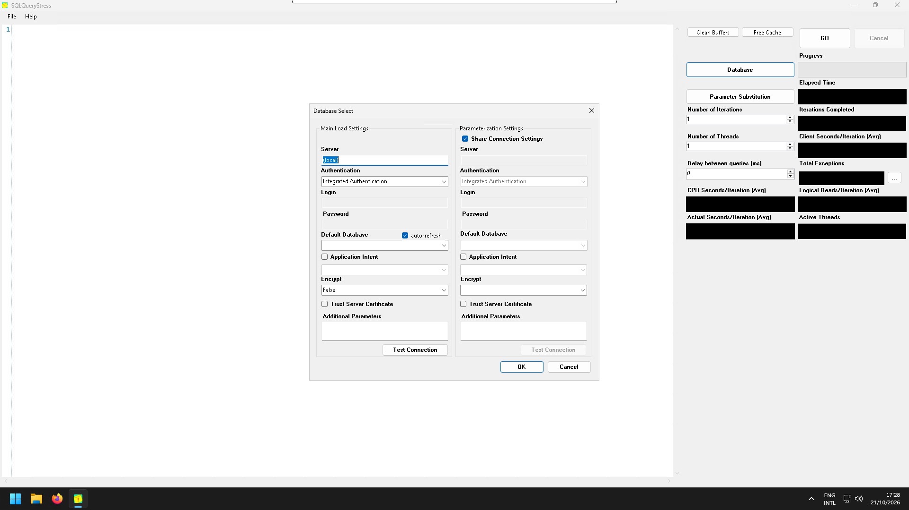
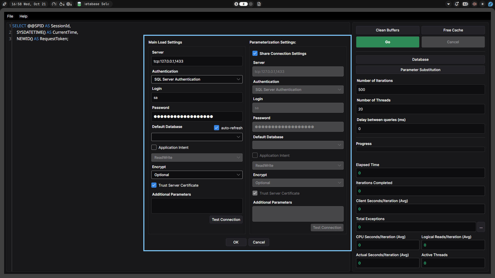
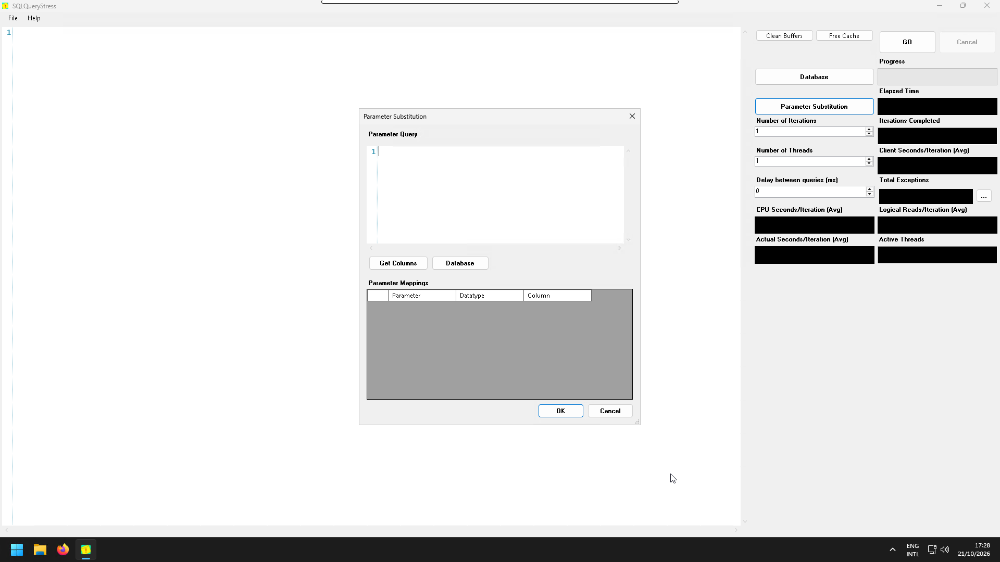
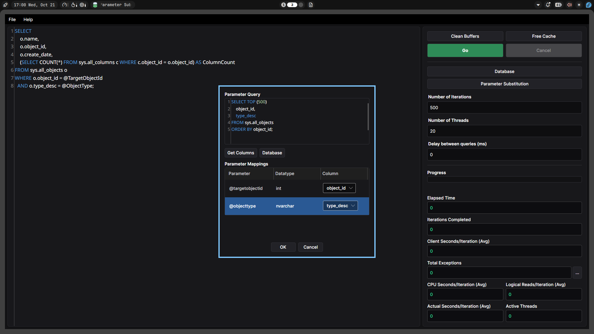
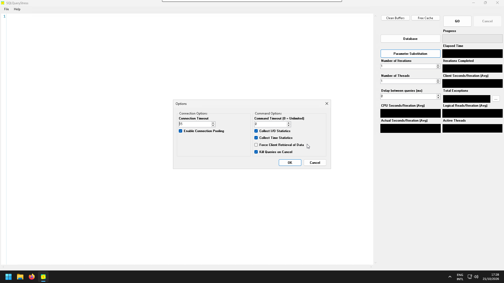
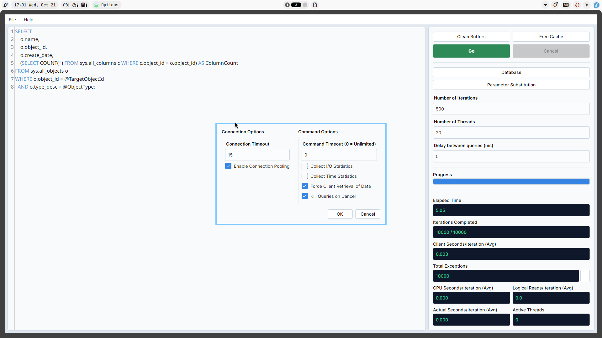
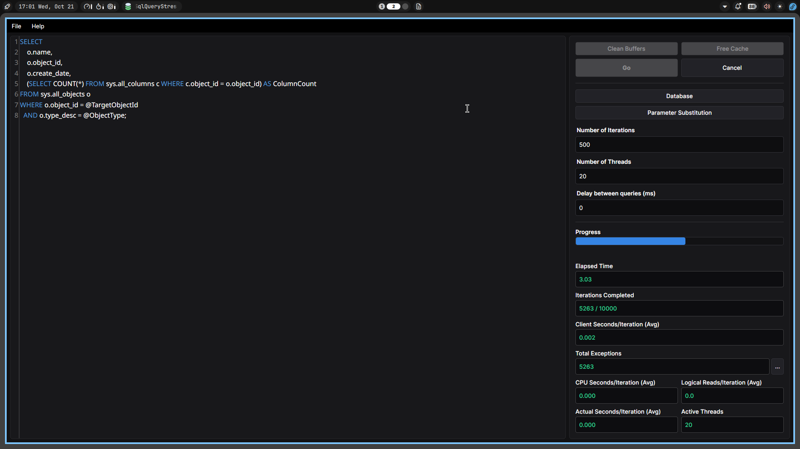
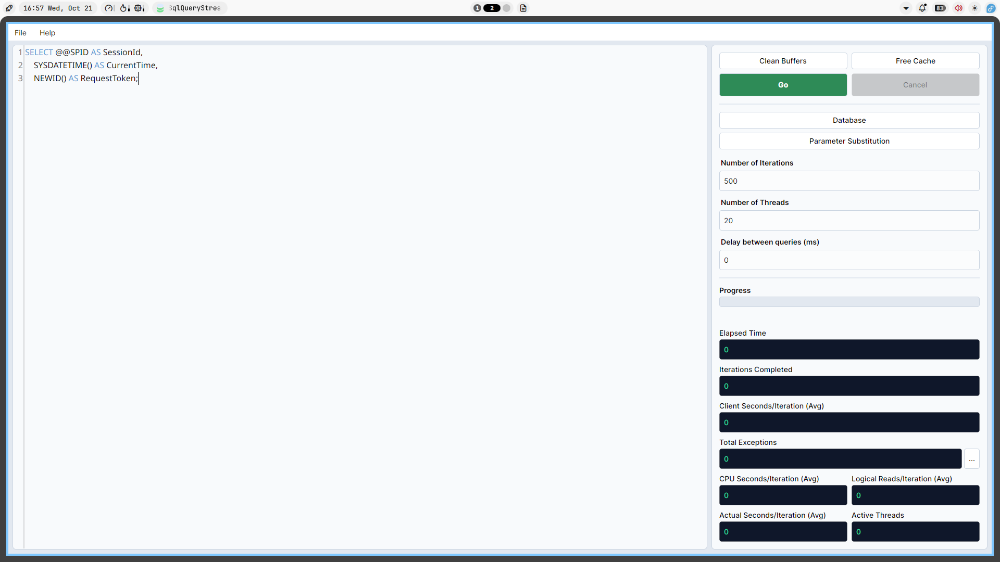
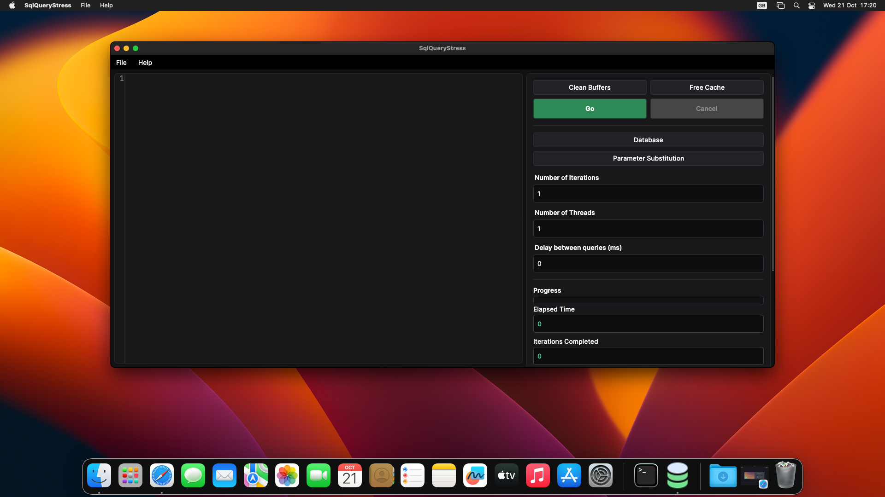
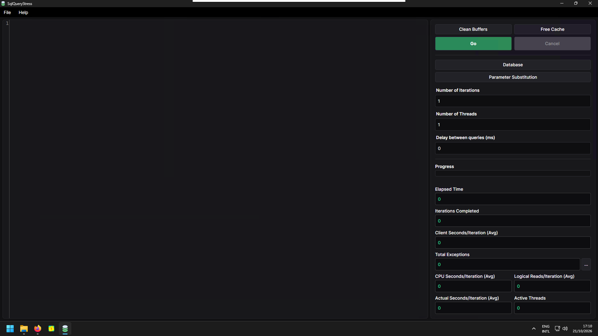

# SqlQueryStress

**SqlQueryStress** is a cross-platform SQL Server benchmarking tool that lets you stress-test T-SQL queries with
configurable concurrency, iterations, and parameter substitution. It is an [Avalonia](https://avaloniaui.net) port of
the original Windows-only [SqlQueryStress](https://github.com/ErikEJ/SqlQueryStress) application, built as part of
the [Avalonia Port Challenge](https://avaloniaui.net/blog/avalonia-port-challenge).

> **More documentation:** The [repository wiki](../../wiki) contains detailed guides on installation, usage,
> troubleshooting, exporting benchmarks, database setup, and more.

## Features

- **Multi-threaded query execution** : Run the same query across multiple threads with a configurable number of
  iterations per thread.
- **Real-time telemetry** : Monitor elapsed time, iterations completed, average client/CPU/actual seconds per iteration,
  logical reads, active threads, and exception counts as the benchmark runs.
- **Parameter substitution** : Bind query parameters to values fetched from a separate parameter query, enabling
  realistic data-driven load testing.
- **SQL Server statistics collection** : Optionally capture `SET STATISTICS IO` and `SET STATISTICS TIME` output to
  measure logical reads, CPU time, and elapsed time per iteration.
- **Buffer and cache management** : Run `CHECKPOINT` and clear data buffers (`DBCC DROPCLEANBUFFERS`) and free the
  procedure cache (`DBCC FREEPROCCACHE`) before running benchmarks for reproducible results.
- **Benchmark export** : Save benchmark results to plain text, CSV, or copy to the clipboard.
- **Settings persistence** : Save and load configuration (connection info, query, iterations, threads, etc.) as JSON
  files.
- **Cancellation support** : Cancel a running benchmark at any time, with an option to kill active queries on the
  server.
- **Cross-platform** : Built on Avalonia UI, targeting .NET 10.0, with Windows, Linux, and macOS support.

## Before & After Comparison

Comparing the original Windows-only legacy application with the modernized **Avalonia 12** port (supporting both Light
and Dark themes):

| View                       |                                         Original App (Windows Legacy)                                         |                                            Avalonia 12 Port (Modern)                                            |
|:---------------------------|:-------------------------------------------------------------------------------------------------------------:|:---------------------------------------------------------------------------------------------------------------:|
| **Database Configuration** |              |                  |
| **Parameter Substitution** |  |  |
| **Options Dialog**         |                |                             |

## Cross-Platform Support

Shipping from a single .NET 10 codebase across **Linux**, **macOS**, and **Windows**:

| Platform                                 |                                               Screenshot                                                |
|:-----------------------------------------|:-------------------------------------------------------------------------------------------------------:|
| **Linux (Dark Mode - Active Benchmark)** |  |
| **Linux (Light Mode)**                   |              |
| **macOS**                                |                  |
| **Windows**                              |              |

## Migration Write-Up

We migrated ErikEJ's Windows-only WPF SqlQueryStress to a cross-platform Avalonia 12 application targeting .NET 10,
preserving all original functionality while rebuilding the entire presentation layer. We added macOS and Linux support,
introduced a fully testable service-oriented architecture, and added automatic system theme syncing. Building the UI was
quite seamless with Avalonia's layout system, and we particularly liked how easy it was to add automatic light/dark
mode.

We preserved the original application's benchmark export formats (plain text, CSV, and clipboard) and maintained the
same format for saving/loading settings such that users could use the same settings file between the two applications.

The migration happened in a couple of distinct phases:
- Building the Views for each of the windows in the original app
- Creating the respective ViewModels for some of the Views. The ViewModels were just skeletons at this point
and was used to map out the data that will be passed to the Views
- Extracting the business logic from the original app and creating services out of it along with some unit tests
- Hooking up those services into the ViewModels and verifying that the features work
- Adding more tests to the test suite
- Deploying the migrated application

### What Translated Cleanly

- **Data Access Layer Reuse:** The original `Microsoft.Data.SqlClient` execution model required no abstraction layer. We
  referenced the same NuGet package directly, and the existing pattern for capturing telemetry data during benchmarks
  worked identically across platforms.
- **App Settings and Parameter Substitution:** Saving/Loading of the application's settings via JSON and the query
  parameter substitution logic carried over smoothly once decoupled from UI controls.
- **SQL Syntax Editing:** Replacing **AvalonEdit** text editor with **AvaloniaEdit** allowed us to preserve full T-SQL
  syntax highlighting with native Light and Dark mode reactivity.

### What Needed Rethinking

- **Decoupling Code-Behind into MVVM:** The original application had business logic embedded in WPF code-behind files
  with no testability. We introduced six service interfaces with dedicated implementations, four view models backed by
  CommunityToolkit.Mvvm's `[ObservableProperty]` and `[RelayCommand]`, dependency injection, and a full xUnit test suite
  covering the load engine, parameter server, query worker, and export formatting all without requiring a live SQL
  Server instance.
- **High-Frequency UI Dispatcher Starvation:** During stress testing with 20+ concurrent threads running sub-millisecond
  queries (10,000+ iterations), sending telemetry updates to the UI thread on every single query completion sometimes
  caused noticeable freezes when opening child windows like `DatabaseSelectWindow`. We solved this by throttling and
  batching UI telemetry updates and dispatching them at `DispatcherPriority.Background` while ensuring the final state
  always flushes on completion.

### Quirks

- **Cross-Platform Packaging:** Packaging self-contained builds from a Linux CI environment for Windows, Linux, and
  macOS surfaced subtle runtime differences. For macOS, single-file publishing (`-p:PublishSingleFile=true`) led to the
  executable not being able to resolve `libSkiaSharp` at launch so we fixed this by disabling single-file publishing for
  macOS and bundling the native libraries with the executable.
- **macOS Gatekeeper Quarantine on Open-Source Builds:** Because open-source builds without a paid Apple Developer ID
  are flagged as *"damaged"* when downloaded, we automated a **Homebrew Cask** updater directly in our GitHub Actions
  release pipeline alongside a terminal installer script (`install_mac.sh`) so macOS users on Intel, M-series, and
  MacBook Neo machines get a zero-friction installation.

## Installation

### macOS

> **macOS Users:** Do not download the `.zip` archive directly from the GitHub Releases page via a web browser. Because
> this open-source application is not notarized with a paid Apple Developer account, macOS Gatekeeper flags browser
> downloads with an *"App is damaged and can't be opened"* error. Instead, install using either the one-line terminal
> installer or Homebrew below so the app launches cleanly out of the box:

#### Option 1: One-Line Terminal Installer (Recommended)

Automatically detects your Mac type (Apple Silicon / MacBook Neo / Intel), installs `SqlQueryStress.app` to
`/Applications`, clears Gatekeeper quarantine flags, and launches the app:

```bash
curl -fsSL https://raw.githubusercontent.com/TruePadawan/SqlQueryStress.Avalonia/master/scripts/install_mac.sh | bash
```

#### Option 2: Homebrew Cask

```bash
# 1. Tap this repository
brew tap truepadawan/sqlquerystress https://github.com/TruePadawan/SqlQueryStress.Avalonia

# 2. Trust the third-party tap (if prompted by your Homebrew version)
brew trust truepadawan/sqlquerystress.avalonia

# 3. Install SqlQueryStress
brew install --cask sqlquerystress
```

### Windows & Linux

Download the latest prebuilt installer or archive for your platform directly from the [Releases](../../releases) page.

## Database support

- **Microsoft SQL Server** (local and Azure SQL Database)
- **Authentication modes:**
    - Windows Integrated Authentication
    - SQL Server Authentication (username/password)
    - Azure Active Directory : Universal with MFA
- **Connection options:**
    - Read/Write or Read-Only application intent
    - Encryption (Optional, False, True, Strict)
    - Trust server certificate
    - Custom additional connection string parameters
    - Connection pooling toggle

## Requirements (Building from Source)

**Application runtime:**

- A desktop platform listed above.
- Network access from the app to your SQL Server instance (default SQL Server port `1433`, unless configured otherwise).

**To build from source:**

- **.NET SDK 10.0** or later (the projects target `net10.0`).

**SQL Server (required to actually run a benchmark, not to build or unit-test):**

- A reachable SQL Server instance or Azure SQL Database, with credentials (or Windows Integrated Authentication / Entra
  ID) that can connect and execute the queries you test.
- The account used needs permission to run the query, and to run `CHECKPOINT`, `DBCC DROPCLEANBUFFERS`, and
  `DBCC FREEPROCCACHE` if you use the cache-management actions (these typically require elevated permissions).

## Quick start

1. **Configure the database connection** : Click **Database** and enter your server, authentication mode, and database
   name.
2. **Write your query** : Enter the T-SQL query in the SQL editor.
3. **Set query parameters** (optional) : Click **Parameter Substitution** to map query parameters to values returned by
   a data-source query.
4. **Configure the benchmark** : Set the number of iterations, threads, and optional delay between queries.
5. **Adjust options** (optional) : Open **File → Options** to toggle connection pooling, statistics collection,
   timeouts, and more.
6. **Run** : Click **Go** to start the benchmark and watch the real-time telemetry panel.
7. **Export results** : After the run completes, use **File → Save Benchmark** to export to text or CSV, or copy to the
   clipboard.

### Options

| Option                         | Description                                                 |
|--------------------------------|-------------------------------------------------------------|
| Enable Connection Pooling      | Toggle SQL connection pooling on/off                        |
| Collect IO Statistics          | Parse `SET STATISTICS IO` output for logical reads          |
| Collect Time Statistics        | Parse `SET STATISTICS TIME` output for CPU and elapsed time |
| Force Client Retrieval of Data | Ensure all result data is fetched to the client             |
| Kill Queries on Cancel         | Cancel active server commands when the benchmark is stopped |
| Connection Timeout             | Timeout in seconds for opening connections                  |
| Command Timeout                | Timeout in seconds for query execution                      |

## Build and test from source

```bash
# Restore dependencies
dotnet restore

# Build the solution
dotnet build

# Run the desktop application
dotnet run --project SqlQueryStress.Desktop

# Run the unit tests
dotnet test
```

The test project uses **xUnit** and **FluentAssertions**. The unit tests exercise the load engine, workers, parameter
server, and export formatting with mocks and do **not** require a live SQL Server instance.
See [CONTRIBUTING.md](CONTRIBUTING.md) for details on running tests and on SQL Server-dependent scenarios.

## Technologies

- **[Avalonia 12](https://avaloniaui.net)** : Cross-platform UI framework
- **[AvaloniaEdit](https://github.com/AvaloniaUI/AvaloniaEdit)** : Syntax-highlighted SQL editor
- **[CommunityToolkit.Mvvm](https://github.com/CommunityToolkit/dotnet)** : MVVM helpers (observable properties, relay
  commands)
- **[Microsoft.Data.SqlClient](https://github.com/dotnet/SqlClient)** : SQL Server database driver
- **Microsoft.Extensions.DependencyInjection** : Dependency injection
- **xUnit + FluentAssertions** : Testing framework

## Contributing

Contributions are welcome. See [CONTRIBUTING.md](CONTRIBUTING.md) for prerequisites, build/test commands, and how to
report bugs and propose changes.

## License

This project is licensed under the MIT License, matching the
original [ErikEJ/SqlQueryStress](https://github.com/ErikEJ/SqlQueryStress) repository. See [LICENSE](LICENSE).

## Acknowledgments

- Original SqlQueryStress by [Adam Machanic](http://dataeducation.com/sqlquerystress-the-source-code/)
- [ErikEJ/SqlQueryStress](https://github.com/ErikEJ/SqlQueryStress) GitHub host and MIT license
- [Avalonia UI](https://avaloniaui.net) for the cross-platform framework
